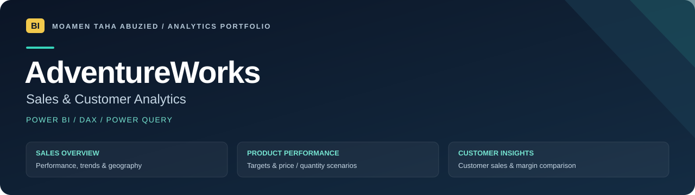

<strong><a href="https://github.com/moamenabden7-max/AdventureWorks-Sales-PowerBI/archive/refs/heads/main.zip">Download project ZIP</a></strong>
&nbsp; · &nbsp;
<a href="powerbi/README.md">Opening guide</a>
&nbsp; · &nbsp;
<a href="docs/MODEL.md">Explore DAX &amp; model</a>

# AdventureWorks · Sales & Customer Analytics

A Power BI portfolio project exploring sales performance, product profitability and customer activity, with price and quantity scenarios.

**Project file: [AdventureWorks.pbip](powerbi/AdventureWorks.pbip).** Download the whole project ZIP so its report and model folders stay together.

## Open the project

1. **[Download the project ZIP](https://github.com/moamenabden7-max/AdventureWorks-Sales-PowerBI/archive/refs/heads/main.zip)** and extract it.
2. Open **`powerbi/AdventureWorks.pbip`** in Power BI Desktop.
3. Set **DataFolder** to your matching local data folder, apply changes and refresh.

The project requires matching compressed snapshots of the imported tables. Data files are not included on GitHub; compatible local data or adapted source queries are required.

## What the report explores

| View | Business questions |
| --- | --- |
| **Sales Overview** | How are revenue, gross profit and orders changing across time and locations? |
| **Product Performance** | Which products drive performance, how do they compare with targets, and how do price/quantity assumptions affect profit? |
| **Customer Insights** | How do customer sales, activity and gross margin compare? |

## Model and report work

Corrected division and scenario references, customer relationship settings, target gauge bindings and customer/margin visuals. [Read the change notes](docs/QUALITY_REVIEW.md).

Source structure was checked. **Opening, refreshing, DAX execution and visual inspection in Power BI Desktop remain pending.**

<strong>Project files and technical documentation</strong>

| Location | Purpose |
| --- | --- |
| [powerbi/](powerbi/) | Project entry point, report definitions and semantic model |
| [docs/](docs/) | Model reference, change notes and Desktop checklist |
| [assets/](assets/) | Portfolio visuals |
| [docs/maintenance/](docs/maintenance/) | Optional audit tools and historical proposals |

The Report and SemanticModel folders are components of this project, not separate report versions.

---

**Moamen Taha Abuzied** · Data Analytics & Business Intelligence  
[LinkedIn](https://www.linkedin.com/in/moamen-taha-data-analyst/) · [Maven Market project](https://github.com/moamenabden7-max/Maven-Market-PowerBI)
