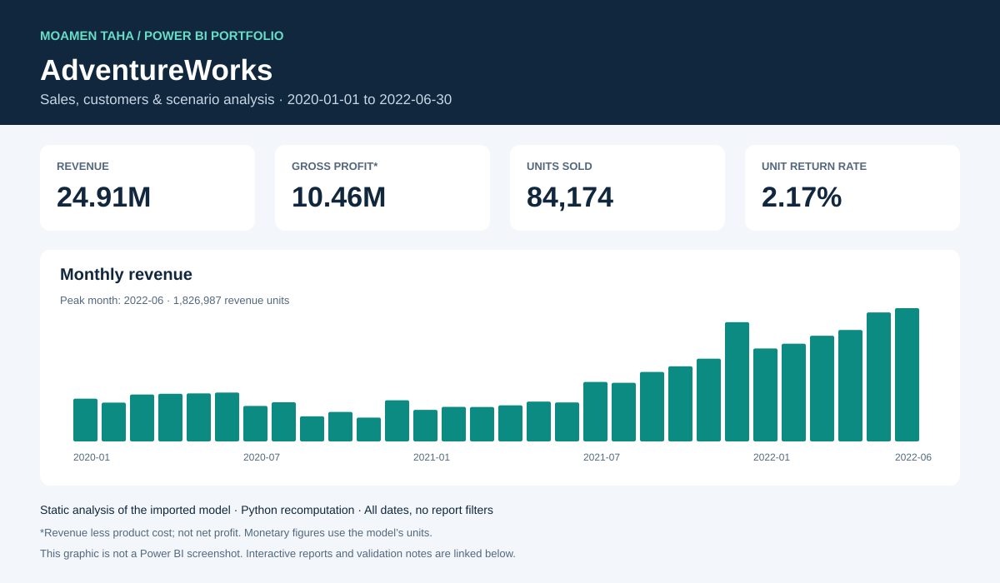

# AdventureWorks | Power BI Analytics

Sales, customers & scenario analysis. A portfolio project by **Moamen Taha Abuzied**.

[Download report](./adventure.pbix) · [Model & DAX](docs/MODEL.md) · [Quality review](docs/QUALITY_REVIEW.md) · [Implementation checklist](docs/DESKTOP_FINISH.md)



## Business focus

Explore sales performance, product profitability, customer activity and the impact of price and quantity assumptions.

## Report tour

- **Sales overview** — revenue, profit, orders, return rate and monthly comparisons.
- **Products** — product performance, targets and adjusted-profit scenarios.
- **Customers** — customer activity, segments and customer-level measures.
- **Supporting pages** — KPIs, scenario gaps and report tooltip.

## Data snapshot

| Metric | All imported data |
| --- | ---: |
| Dates | 2020-01-01–2022-06-30 |
| Fact rows | 56,046 |
| Units sold | 84,174 |
| Revenue | 24,914,586.82 |
| Product cost | 14,456,871.39 |
| Gross profit (revenue − product cost) | 10,457,715.43 |
| Gross margin | 41.97% |
| Returned units / sold units | 2.17% |

Order definition: 25,164 distinct order numbers.

These numbers were independently recomputed from the embedded tables using Python. They are **not DAX-engine results** and do not reproduce saved report filters. Amounts use the model's monetary units; profit here excludes operating expenses. [Evidence and source-file hash](docs/audit-results.json).

## Open and explore

1. Open the [PBIX file](./adventure.pbix) and choose **Download raw file** on GitHub.
2. Open it in Power BI Desktop and explore the pages and slicers.
3. To refresh, obtain the original source files and update the local source paths. Those source files are not distributed here.

## Technical work

- Power BI report design and interactive filtering.
- DAX measures for revenue, product cost, profit, returns and prior-month comparisons.
- Price/quantity scenario measures and customer/product analysis.
- A reproducible Python audit of key coverage, calendar continuity and aggregate arithmetic.

## Validation and improvements

The repository includes a [quality review](docs/QUALITY_REVIEW.md), [proposed measure fixes](improvements/measure-fixes.dax), an optional [report theme](improvements/portfolio-theme.json) and an [implementation checklist](docs/DESKTOP_FINISH.md).

The review identifies a customer relationship that needs correction, an undefined `qu` reference in a scenario measure, and return-rate and gauge presentation issues. **These changes have not been applied to the PBIX.** The analysis graphic above is an independent aggregate summary, not a screenshot of the report.

## Repository contents

| Path | Purpose |
| --- | --- |
| `adventure.pbix` | Report with its imported model |
| `assets/` | Analysis summary graphic |
| `docs/` | Model reference, findings, audit evidence and implementation checklist |
| `improvements/` | Proposed DAX changes and optional theme |
| `tools/audit_model.py` | Read-only aggregate audit |
| `requirements.txt` | Dependencies for the optional audit |

Reproduce the audit locally:

```bash
python -m pip install -r requirements.txt
python tools/audit_model.py "adventure.pbix" --output audit-results.json
```

## More work

[Maven Market retail analysis](https://github.com/moamenabden7-max/Maven-Market-PowerBI) · [LinkedIn](https://www.linkedin.com/in/moamen-taha-data-analyst/)
